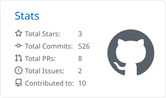
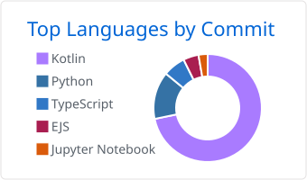

# Hi, I'm Khaled Bahaaeldin 👋

Software engineer and Computer Science graduate (Alamein International University). I build AI products end to end: retrieval and agent backends, clean web and mobile interfaces, and the infrastructure that runs them. I care about privacy-first software and open source, and I'm co-founder of Monofix, a software house.

---

### 📊 Stats

  <picture>
    <source media="(prefers-color-scheme: dark)" srcset="stats/stats-github_dark.svg">
    
  </picture>
  <picture>
    <source media="(prefers-color-scheme: dark)" srcset="stats/most-commit-language-github_dark.svg">
    
  </picture>

---

### 🧰 Skills

| Area | Tools |
|:--|:--|
| **Languages** | Python · Kotlin · TypeScript · JavaScript · SQL · Java · C++ |
| **Backend & AI** | FastAPI · Celery · LangChain · LangGraph · RAG · ChromaDB · OpenAI · Gemini · Ollama |
| **Frontend & Mobile** | React · Next.js · Tailwind CSS · Jetpack Compose · Material 3 |
| **Data** | PostgreSQL · Redis · Room · Prisma |
| **Infra** | Docker · Caddy · GitHub Actions · Linux servers · CI/CD |

---

### 🚀 Showcase

**[Emberbyte](https://github.com/Khaledbahaaeldin/Emberbyte)** · Open source (GPL-3.0) 
A free Android data-usage monitor with no internet permission, no accounts and no telemetry. It forecasts when your quota will run out, has home-screen widgets and per-app budgets, and makes encrypted backups with Argon2id and AES-256-GCM. 
[Website](https://emberbyte-site.vercel.app) · [Download](https://github.com/Khaledbahaaeldin/Emberbyte/releases/latest) 
`Kotlin` `Jetpack Compose` `Material 3` `Room` `Glance` `GitHub Actions`

**Mindex** · Private product, co-built with a teammate 
An AI document-chat platform: upload PDF, Office and text files, then ask questions with page-level citations, a side-by-side viewer and voice. I work on the RAG pipeline, LangGraph agents, async workers, the web app and the production deployment. 
`Next.js` `React` `TypeScript` `FastAPI` `LangGraph` `ChromaDB` `Celery` `PostgreSQL` `Redis` `Docker`

**LiteraryHub** · Graduation project 
An AI-powered Arabic literature platform, built with a team of four and used by over 100 people in its first month. It does topic detection, personalized book recommendations, AI-generated cover art and e-book to audiobook conversion. 
`Python` `Django` `React` `MongoDB` `Docker`

---

### 📫 Get in touch

- ✉️ [khaled.b.20251@gmail.com](mailto:khaled.b.20251@gmail.com)
- 💼 [linkedin.com/in/Khaledbahaaeldin](https://linkedin.com/in/Khaledbahaaeldin)
- 🌐 [emberbyte-site.vercel.app](https://emberbyte-site.vercel.app)
- 🐙 [github.com/Khaledbahaaeldin](https://github.com/Khaledbahaaeldin)
